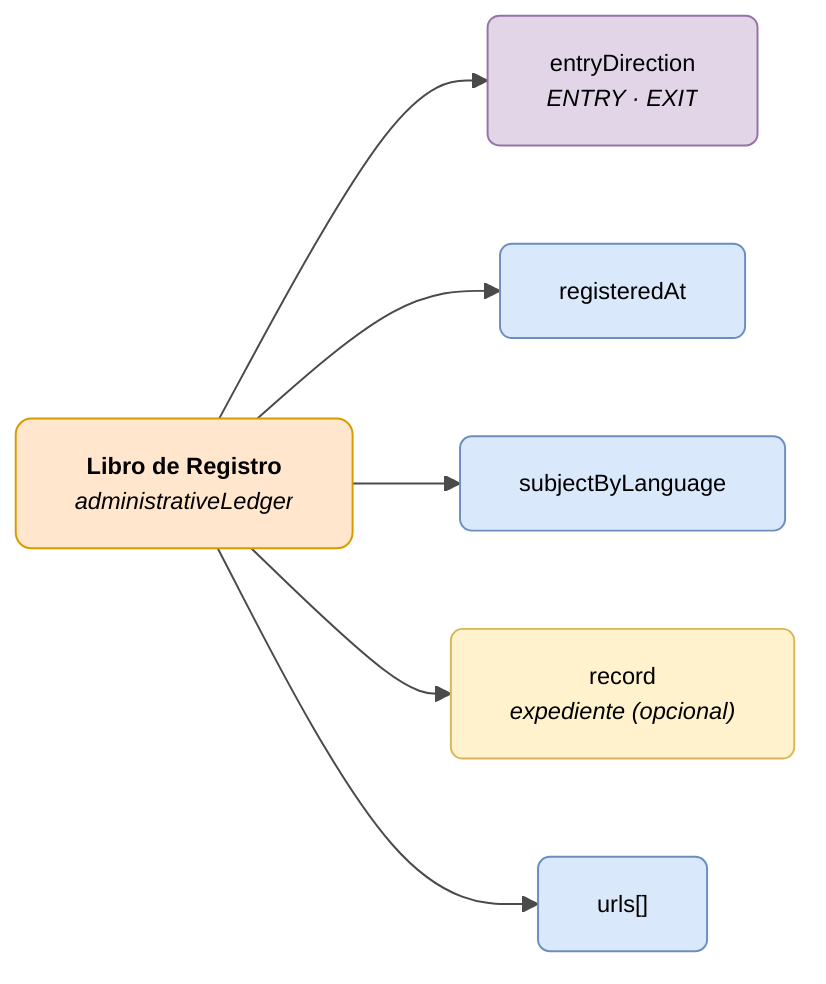

# :material-book-open-variant: Libro de Registro (Administrative Ledger)

> - **Versión:** `v{{ dena.version }}`
> - **Fecha:** {{ dena.date }}
> - **Test:** [DN99DENATestMockObjFactoryForAdministrativeLedger.java]({{ repos.interop_test_blob }}/denaTestCommonDataClasses/src/main/java/dena/test/common/data/ledger/DN99DENATestMockObjFactoryForAdministrativeLedger.java)
> - **Código:** [DN00AdministrativeLedger.java]({{ repos.common_data_api_blob }}/denaCommonDataAPIAdministrativeLedgerModelClasses/src/main/java/dena/api/data/model/ledger/DN00AdministrativeLedger.java)

## Descripción

Representa un asiento de entrada o salida en el libro de registro de la administración. Es el tipo de dato que reemplaza al antiguo `ADMINISTRATIVE_OFFICIAL_REGISTER` a partir de la versión 0.5.20.

> Ver también: [campos-comunes.md](./campos-comunes.md) para campos heredados (`oid`, `id`, `urls`, `originAdminRef`, `aboutPersonRef`)



| Color | Significado |
|-------|-------------|
| 🟠 Naranja | Objeto principal |
| 🟣 Violeta | Enums / estados |
| 🔵 Azul claro | Campos de datos |
| 🟡 Amarillo | Referencia opcional a expediente |

---

## 🔗 Código fuente

| Clase | Repositorio |
|-------|-------------|
| DN00AdministrativeLedger | [Ver código]({{ repos.common_data_api_blob }}/denaCommonDataAPIAdministrativeLedgerModelClasses/src/main/java/dena/api/data/model/ledger/DN00AdministrativeLedger.java) |
| DN00AdministrativeLedgerEntryDirection | [Ver código]({{ repos.common_data_api_blob }}/denaCommonDataAPIAdministrativeLedgerModelClasses/src/main/java/dena/api/data/model/ledger/DN00AdministrativeLedgerEntryDirection.java) |
| DN00AdministrativeLedgerStateCode | [Ver código]({{ repos.common_data_api_blob }}/denaCommonDataAPIAdministrativeLedgerModelClasses/src/main/java/dena/api/data/model/ledger/DN00AdministrativeLedgerStateCode.java) |

---

## 🧪 Tests y ejemplos

| Mock Factory | Repositorio |
|--------------|-------------|
| DN99DENATestMockObjFactoryForAdministrativeLedger | [Ver código]({{ repos.interop_test_blob }}/denaTestCommonDataClasses/src/main/java/dena/test/common/data/ledger/DN99DENATestMockObjFactoryForAdministrativeLedger.java) |

---

## Atributos JSON

| Campo | Tipo | Obligatorio | Ejemplo | Descripción |
|-------|------|:-----------:|---------|-------------|
| `type` | `String` | ✅ | `"administrativeLedger"` | Discriminador polimórfico |
| `oid` | `String` | ✅ | `"LED-OID-001"` | Identificador técnico único |
| `id` | `String` | ✅ | `"LED-2024-00789"` | Número de asiento registral |
| `registeredAt` | `String` (ISO 8601) | ✅ | `"2024-04-10T08:30:00Z"` | Fecha y hora del asiento |
| `entryDirection` | `Object` | ✅ | `{"stateCode":"ENTRY"}` | Dirección del asiento |
| `entryDirection.stateCode` | `String` | ✅ | `"ENTRY"` | `ENTRY` (entrada) o `EXIT` (salida) |
| `subjectByLanguage` | `LanguageTexts` | ❌ | `{"SPANISH":"Solicitud licencia"}` | Asunto del asiento registral |
| `record` | `Object` | ❌ | *(referencia al expediente)* | Expediente vinculado (si aplica) |
| `urls` | `Array` | ❌ | *(ver [campos-comunes.md](./campos-comunes.md))* | URLs de acceso |

---

## Dirección del asiento (`entryDirection.stateCode`)

| Código | Descripción |
|--------|-------------|
| `ENTRY` | Asiento de entrada |
| `EXIT` | Asiento de salida |

---

## Ejemplo JSON

```json
{
  "type": "administrativeLedger",
  "oid": "LED-OID-001",
  "id": "LED-2024-00789",
  "registeredAt": "2024-04-10T08:30:00Z",
  "entryDirection": {
    "stateCode": "ENTRY",
    "description": { "SPANISH": "Entrada", "BASQUE": "Sarrera" }
  },
  "subjectByLanguage": {
    "SPANISH": "Solicitud de licencia de obras",
    "BASQUE": "Obra-lizentzia eskaera"
  },
  "urls": [
    { "url": "https://sede.miadmin.eus/registro/LED-2024-00789", "language": "SPANISH", "tags": ["default"] }
  ]
}
```

<!-- DENA-DOC-FOOTER -->
---
<sub>DENA Docs v{{ dena.version }} · {{ dena.date }}</sub>
